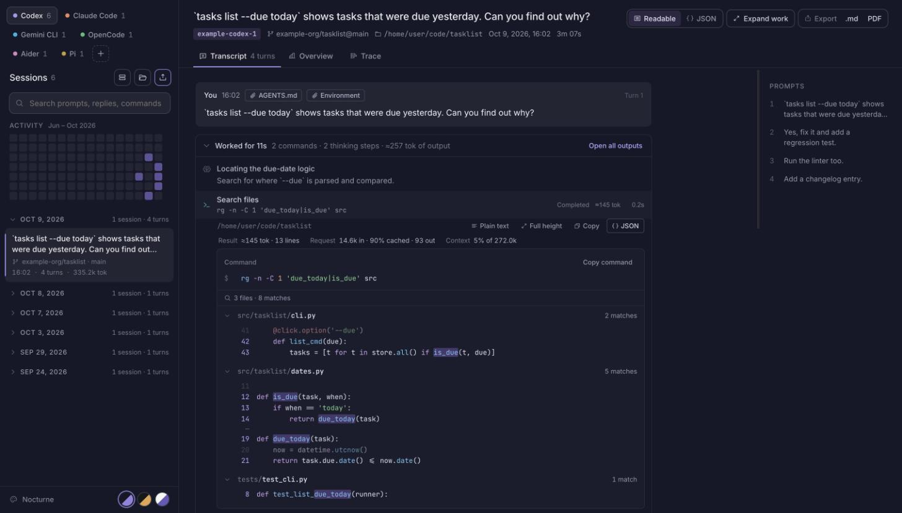
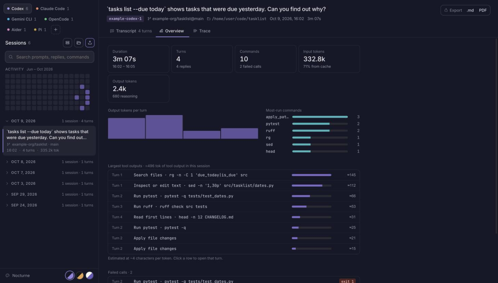
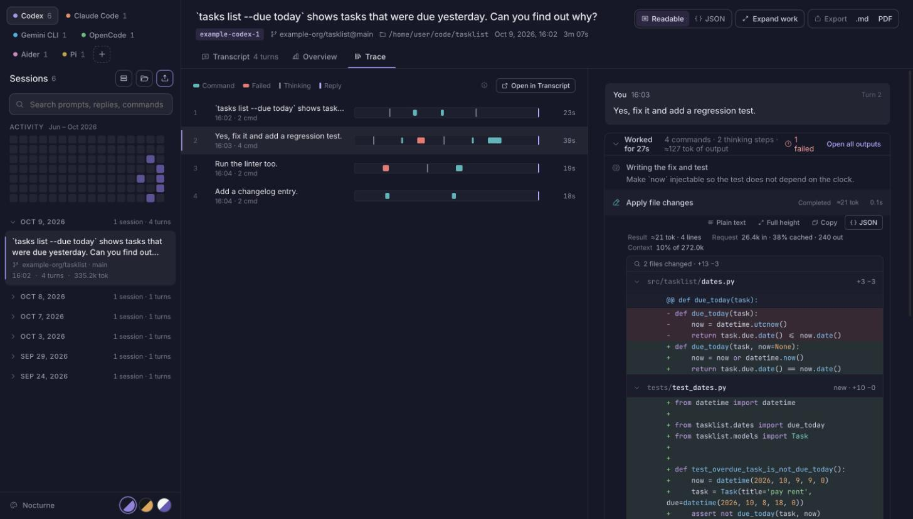

# ReadBack

Read, search and analyze the session logs your coding agents leave on disk.
Supports Codex, Claude Code, Gemini CLI, Pi, OpenCode and Aider.



Coding agents record every prompt, reasoning step, command and reply in local log
files. ReadBack turns those files into something you can actually read:
a clean transcript, a per-session dashboard and a timeline of each turn. It is a
desktop app built with Tauri 2 (Rust) and React + TypeScript, and it works
entirely offline.

## Features

- **One tab per agent.** Default session folders are discovered automatically
  and new sessions appear while the agent is still writing them.
- **Readable transcripts.** Prompts, replies (with Markdown and syntax-highlighted
  code), reasoning summaries and the injected context (AGENTS.md, environment) are
  shown in order. Long work is folded into "Worked for 27s · 4 commands" blocks.
- **Commands you can understand.** Each tool call shows what it did, its exit
  status, run time and how many tokens its output added to the context. Search
  results are grouped by file with matches highlighted, file reads are shown with
  line numbers, and patches render as diffs.
- **Overview.** Duration, turns, commands, input/output tokens and cache hit rate,
  tokens per turn, most-run commands, the largest tool outputs and every failed call.
- **Trace.** One row per turn on its own timeline, with commands, failures,
  thinking and replies marked, next to the turn itself.
- **Search and navigation.** Search titles and the prompts, replies and commands
  of loaded sessions in the active agent tab, an activity calendar, and a prompt
  outline to jump between turns. Discovered sessions are searched by title until
  opened; the app does not yet index the full contents of every log on disk.
- **Raw JSON when you need it.** Switch any item, or the whole transcript, to the
  original JSONL events with their line numbers.
- **Export** a session to Markdown or PDF.
- **Three themes:** Nocturne, Graphite and Daylight.
- **Handles large log folders.** The session list is built from lightweight
  summaries cached on disk; a session is parsed in full only when you open it.

| Overview | Trace |
|---|---|
|  |  |

## Supported agents

| Agent | Where sessions come from | Notes |
|---|---|---|
| Codex CLI | `~/.codex/sessions/**/rollout-*.jsonl` | Discovered automatically |
| Claude Code | `~/.claude/projects/**/*.jsonl` | Discovered automatically |
| Gemini CLI | `~/.gemini/tmp/**/session-*.json` / `.jsonl` | Discovered automatically; snapshots, patches and rewinds |
| Pi | `~/.pi/agent/sessions/**/*.jsonl` | Discovered automatically; shows the latest active branch |
| OpenCode | Exported session JSON | Import an export, or open a folder of exports |
| Aider | `<repo>/.aider.chat.history.md` | Import the file or open the project folder |

Add or remove agents with the **+** button. You can always import files by hand
or drag a file or folder onto the window.

- **OpenCode** keeps its sessions in a database. Export a conversation with the
  OpenCode CLI's export command and import the JSON.
- **Aider** history has prompts and replies but no structured tool calls,
  per-turn timestamps or token counts. Missing values are shown as unknown, never
  estimated.

## Privacy

Session logs contain your prompts, file paths and command output. ReadBack
reads them locally and never sends them anywhere. It does not read authentication
files, does not modify agent folders or databases, and never executes code found
in a log.

## Install

There are no prebuilt releases yet. To build the app yourself you need:

- Node.js 20 or newer, with npm
- Rust (stable) and the [Tauri prerequisites](https://v2.tauri.app/start/prerequisites/) for your OS

```sh
npm install
npm run tauri build
```

The installer is written to `src-tauri/target/release/bundle/`.

## Development

```sh
npm install
npm run tauri dev    # desktop app with hot reload
npm run dev          # UI only, in a browser, with synthetic demo sessions
npm test             # frontend tests (Vitest)
cargo test --manifest-path src-tauri/Cargo.toml   # Rust tests
```

### How it is built

- **`src-tauri/`** (Rust): scans agent folders, builds a small summary of each
  session file for the list (cached in the app data directory), watches folders
  for changes and reads files on demand.
- **`src/adapters/`**: one adapter per agent turns a raw log into the shared
  session model in `src/model.ts`. `codex.ts` is the reference implementation.
- **`src/lib/tools.ts`, `src/lib/highlight.ts`**: readable commands, structured
  output views (search results, file reads, diffs) and syntax highlighting.
- **`fixtures/`**: synthetic sessions only, one per agent, used by the tests.
  `fixtures/demo/` feeds the browser preview and the screenshots above; it is
  generated by `scripts/make_demo_sessions.py`.

Log formats were checked against real session files and these references:
[Claude Code sessions](https://code.claude.com/docs/en/sessions),
[Gemini CLI recording types](https://github.com/google-gemini/gemini-cli/blob/main/packages/core/src/services/chatRecordingTypes.ts),
[Pi session format](https://github.com/badlogic/pi-mono/blob/main/packages/coding-agent/docs/session.md),
[OpenCode export](https://github.com/anomalyco/opencode/blob/dev/packages/opencode/src/cli/cmd/export.ts),
[Aider history writer](https://github.com/Aider-AI/aider/blob/main/aider/io.py).

### Adding an agent

1. Create `src/adapters/<agent>.ts` exporting `(input, fileName) => Session | null`.
2. Register it in `src/lib/agents.ts` with its default folder and file extensions.
3. Add a list summary for it in `src-tauri/src/summary.rs`.
4. Add a small **synthetic** fixture under `fixtures/` and tests under `tests/`.

## Contributing

Issues and pull requests are welcome. Please make sure `npm test` and
`cargo test` pass, and never commit real session logs: they contain private
prompts and paths. Use synthetic fixtures instead.

## License

[MIT](LICENSE) © 2026 mak1jk.

You may use, modify and redistribute this project, including commercially, as
long as the copyright notice and the license text are kept in every copy or
substantial portion of it.
